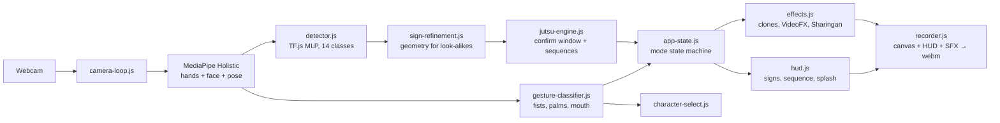
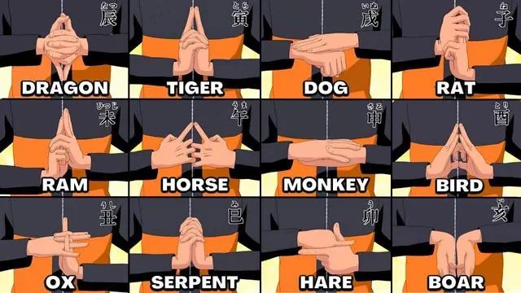

# Naruto Jutsu — real-time hand-seal recognition in the browser

> Weave Naruto hand seals in front of your webcam and cast the jutsu: Shadow Clones, Rasengan, Chidori,
> the Uchiha Fireball and the Sharingan. Everything runs locally in the browser; no server, no install.

<!-- Hero clip: record with the app's own recorder (see "Recording a demo"), then
     ffmpeg -i demo.mp4 -vf "fps=15,scale=720:-1:flags=lanczos" -loop 0 assets/readme/hero.gif
     and add:    -->

**What it shows:** a custom-trained hand-sign classifier, a real-time computer-vision pipeline at 20–30 fps, a
state machine that turns noisy per-frame predictions into deliberate actions, and canvas compositing of video
effects anchored to your hands, mouth and eyes.

---

## Highlights

- **Custom dataset + model.** A 14-class MLP (TensorFlow.js) over both hands' 3-D landmarks from MediaPipe Holistic,
  trained on my own recorded samples plus a public image dataset converted to landmarks. Geometric rules separate the
  look-alike seals (Tiger / Ram / Dragon / Serpent).
- **From noisy frames to intent.** A 45-frame confirmation window, multi-seal sequences with timeouts, an
  anti-cross-seed cooldown, and a two-step "READY → gesture" activation so jutsu never fire by accident.
- **Effects anchored to the body.** Looping video sprites blended over the camera at the palm (Rasengan, Chidori) or
  the mouth (Fireball), procedural Sharingan eyes on face landmarks, and Shadow Clones built from a live selfie-
  segmentation cutout of you.
- **Built to survive a live demo.** Camera unplugged → automatic reconnect. Camera blocked, offline CDN or missing
  model → a clear on-screen message and a retry. On a slow laptop it drops from 1080p to 720p by itself (only between
  jutsu). Animations run at the same speed at any frame rate.
- **Every gesture has a keyboard fallback** that goes through the same code path, so a demo never depends on one seal.
- **Tested.** 13 browser test pages (235 assertions) for the engine, state machine, gesture rules, camera health,
  recorder and trainer data split, plus headless end-to-end runs of every jutsu with a simulated camera.

## Jutsu

| Character | Jutsu | How to cast | Keyboard |
|---|---|---|---|
| Naruto | **Shadow Clone** | Hold the cross seal (Kage Bunshin) ~1.5 s: 18 clones burst from smoke | `k` |
| Naruto | Release clones | Left hand: index + middle up, others curled | `g` |
| Naruto | **Rasengan** | Release sign with the left hand, then open your right palm; close the fist to end | `g`, then `p` / `p` |
| Sasuke | **Chidori** | Ox → Hare → Monkey, then open your right palm | `2 4 9`, then `p` / `p` |
| Sasuke | **Fireball** | Serpent → Ram → Monkey → Boar → Horse → Tiger, then open your mouth | `6 8 9 = 7 3`, then `m` / `m` |
| Sasuke | **Sharingan** | Automatic when Sasuke is selected | — |

Pick a character first: make two fists, point your left index finger and move it to browse, hold your left palm open
to choose, thumb up to close (keyboard: `c`, arrows, `Enter`). No character = no jutsu.

Other keys: `r` release the active jutsu · `d` demo mode (hides controls, cursor, fps) · `b` cinematic bars ·
`f` fullscreen · `l` debug strip · seal keys `1`–`9`, `0`, `-`, `=` inject seals 0–11.

## Run it

```bash
cd naruto-jutsu
python serve.py            # no-cache local server on port 8765
```

Open **http://localhost:8765/app/** in Chrome or Edge and allow the camera. (Opening the HTML as a `file://` URL
does not work: MediaPipe needs an HTTP origin.) Add `?debug=1` to the URL for the state/fps strip and test hooks.

## How it works



Each frame: Holistic returns hand, face and pose landmarks → each hand is wrist-centred and scale-normalised into a
126-value vector → the MLP predicts a seal → geometric rules correct the confusable quartet → the engine confirms a
seal only after it dominates a 45-frame window at ≥ 0.90 confidence → the state machine (IDLE, CAROUSEL, SEQUENCE,
READY, JUTSU, RELEASING) decides what may happen next → effects and HUD render on two stacked canvases, scaled by the
real camera resolution. All tunables live in `app/modules/config.js`.

## Training story

- **Data.** I recorded live samples of all 14 classes with the in-browser trainer (`/trainer/`), then converted a
  public "Naruto hand sign" image dataset into landmarks offline (`landmark-collector/`, Python + MediaPipe) and kept
  it only because it improved accuracy on my live hold-out. A second dataset was rejected (tight crops gave noisy
  landmarks); a third had corrupt labels.
- **Model.** Dense 128 → 64 → 32 → 14 with BatchNorm and dropout, trained in the browser or with an exported Keras
  copy that writes TF.js weights directly.
- **Honest evaluation.** Consecutive webcam frames are nearly identical, so a random train/validation split measures
  memorisation. The trainer now validates on the last 15% of each sign's recordings and augments training rows only.
- **Hard cases.** Tiger, Ram, Dragon and Serpent differ by a few millimetres of finger overlap. A small geometric
  layer (relative fingertip heights, pinky curl) corrects them when the network is unsure; three of its test fixtures
  are deliberately left failing until more live data is recorded, rather than tuning thresholds to pass.

| ID | Seal | ID | Seal | ID | Seal |
|---|---|---|---|---|---|
| 0 | Rat (子) | 5 | Serpent (巳) | 10 | Dog (戌) |
| 1 | Ox (丑) | 6 | Horse (午) | 11 | Boar (亥) |
| 2 | Tiger (寅) | 7 | Ram (未) | 12 | Shadow Clone |
| 3 | Hare (卯) | 8 | Monkey (申) | 13 | None |
| 4 | Dragon (辰) | 9 | Bird (酉) | | |



### Train your own model

1. Open **http://localhost:8765/trainer/**, click a sign, press **R**: 3-second countdown, then 4 seconds of capture.
2. Record several takes per sign at different distances and angles until each card shows its target
   (150 per sign, 300 for None: hands at rest, one hand, off-screen).
3. **Train** (shows held-out accuracy), then **Save Model** and put `gesture-model.json` +
   `gesture-model.weights.bin` into `models/`. Reload the app.

## Recording a demo

Click **⏺ Record**, press `d` for demo mode, perform, press `d` again and click **⏹ Stop**. The `.webm` contains
the effects, the HUD and the sound, never the controls bar. Convert for LinkedIn with
`ffmpeg -i in.webm -c:v libx264 -crf 20 -c:a aac out.mp4`.

## Testing

Serve the folder, then open any page in `app/tests/` (for example
`http://localhost:8765/app/tests/test-jutsu-engine.html`); each prints `N passed, M failed`. The pages need no
build step or test framework: plain HTML + ES modules.

## Project layout

```
app/            real-time app: app.js (main loop), modules/ (one concern each), tests/ (browser test pages)
trainer/        in-browser data collection + training (dataset.js holds the split/augment/import logic)
landmark-collector/   offline image → landmark conversion, evaluation and Keras export (Python)
models/         trained model + recorded samples
assets/         seal images, character cards, smoke sprites, effect clips, sounds
serve.py        dev server (threaded, keep-alive, no-cache)
```

## Limitations

- The classifier is trained on one person's hands; other people may need to record their own samples.
- Tracking needs decent front lighting; desktop Chrome or Edge recommended (MediaPipe Holistic is GPU-heavy).
- MediaPipe Holistic is a legacy solution; migrating to `@mediapipe/tasks-vision` is on the roadmap.

## Credits and licences

- Code: MIT (see `LICENSE`). The open-palm distance test follows anime-ar-engine (MIT).
- Libraries (CDN, pinned): MediaPipe Holistic and Selfie Segmentation (Apache-2.0), TensorFlow.js (Apache-2.0).
- Effect clips: Chidori from FootageCrate, Fireball flames from Vecteezy, used under their free licences.
- Naruto, its characters, hand-seal imagery and names belong to Masashi Kishimoto / Shueisha / TV Tokyo; they are used
  here for a non-commercial, educational fan project.
